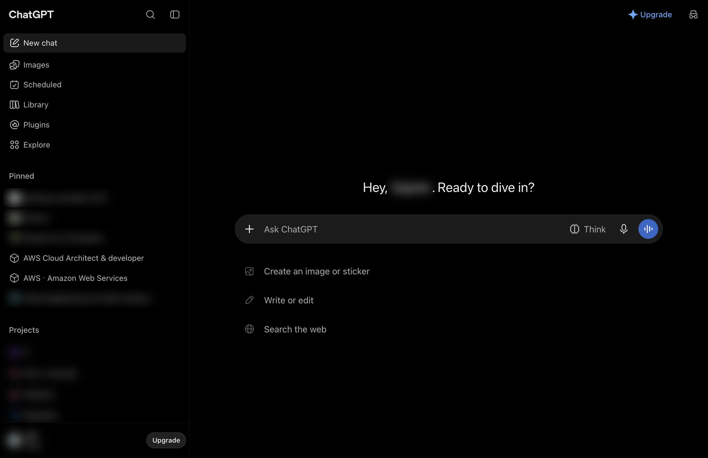
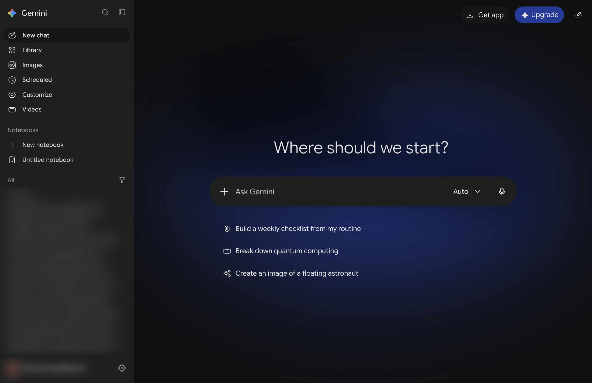
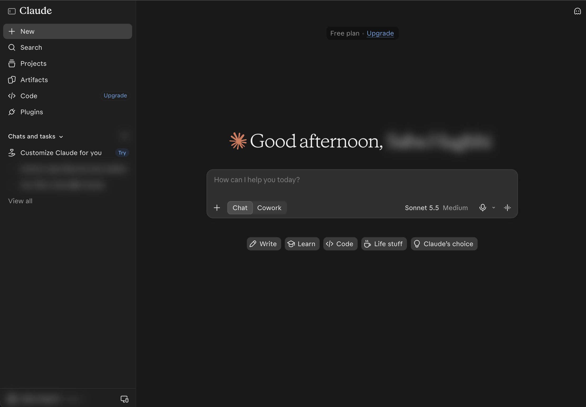
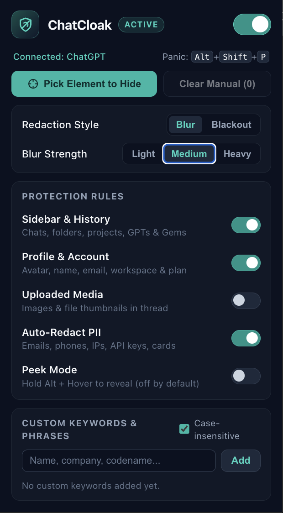

<div align="center">
  
  <h1>ChatCloak</h1>
  <p>Hide, blur, or blackout sensitive info across 13 AI chat web apps while screen sharing or recording.</p>
  <p>
    <a href="https://github.com/PapaDanielVi/ChatCloak/releases/latest"></a>
    <a href="LICENSE"></a>
    
    
  </p>
</div>

ChatCloak is a Chrome extension (Manifest V3) built for live demos, pair programming, calls, and screen recordings. It runs strictly on your device with zero network requests, zero telemetry, and minimal permissions (`storage` and `activeTab`).

## Screenshots

| ChatGPT (Start Page & Sidebar) | Google Gemini (History & Account) | Claude (Start Page & Sidebar) |
| :---: | :---: | :---: |
|  |  |  |

<div align="center">
  <p><strong>Extension Popup</strong></p>
  
</div>

## Supported Sites

- ChatGPT (`https://chatgpt.com/*`)
- Google Gemini (`https://gemini.google.com/*`)
- Claude (`https://claude.ai/*`)
- Grok (`https://grok.com/*` and `https://x.com/i/grok*`)
- DeepSeek (`https://chat.deepseek.com/*`)
- Perplexity (`https://perplexity.ai/*` and `https://www.perplexity.ai/*`)
- Microsoft Copilot (`https://copilot.microsoft.com/*` and `https://copilot.cloud.microsoft/*`)
- Meta AI (`https://meta.ai/*` and `https://www.meta.ai/*`)
- Qwen (`https://chat.qwen.ai/*`)
- Mistral (`https://chat.mistral.ai/*`)
- Poe (`https://poe.com/*`)
- Kimi (`https://kimi.com/*` and `https://www.kimi.com/*`)
- Duck.ai (`https://duck.ai/*`)

## Features

- **Zero-flicker loading:** Injects site-scoped CSS guards at `document_start` alongside a local boot cache so sidebar titles, profile badges, and start-page greetings do not flash during reloads.
- **SPA route safety:** Detects `pushState`, `replaceState`, `popstate`, and DOM navigation transitions, including activating on `x.com/i/grok` and stripping all cloaks if you navigate back to the X timeline.
- **Panic shortcut (`Alt+Shift+P`):** Toggles protection ON or OFF across all open supported tabs at once (`Option+Shift+P` on macOS, configurable at `chrome://extensions/shortcuts`).
- **Per-site controls:** Toggle protection for the active site directly in the popup or manage all 13 platforms from the collapsible Supported Platforms list.
- **Sidebar and history cloaking:** Blurs or blacks out past chats, folders, projects, pinned conversations, custom GPTs, Gems, Spaces, bots, and workspace switchers.
- **Profile and identity protection:** Hides user avatars, account buttons, plan badges, emails, X `@handles`, work/tenant badges, and personalized start-page greetings (such as `Good to see you, <Name>.`).
- **Uploaded media and Shadow DOM support:** Optionally blurs image attachments, Grok Imagine previews, and OneDrive/SharePoint file chips, including components inside open Shadow DOM roots on Microsoft Copilot.
- **Automatic PII and secret redaction:** Detects and masks emails, phone numbers, IPv4 and IPv6 addresses, credit card sequences, Bearer tokens, JWTs, and common API key prefixes (`sk-`, `sk-ant-`, `AIza`, `ghp_`, `github_pat_`, `AKIA`, `xox*`, Stripe keys) during token streaming and inside collapsible reasoning blocks.
- **Custom keywords and phrases:** Add names, client names, companies, or internal codenames with optional case-insensitive matching.
- **Blur or Blackout styles:** Pick `Blur` (`Light`, `Medium`, or `Heavy`) or solid `Blackout` bars.
- **Click-to-cloak element picker:** Highlight and click any message, code block, image, or UI block (including Shadow DOM elements) to hide it for the current session. Press `Esc` to exit picker mode.
- **Peek Mode (off by default):** When enabled, holding `Alt` and hovering over a cloaked item temporarily reveals it.

## Install

### Option 1: Download Release Zip

1. Download `chatcloak-v1.1.0.zip` from the [latest GitHub Release](https://github.com/PapaDanielVi/ChatCloak/releases/latest) and extract it.
2. Open `chrome://extensions` in Chrome.
3. Enable **Developer mode** in the top-right corner.
4. Click **Load unpacked** and select the extracted folder.
5. Pin ChatCloak to your toolbar. A teal `ON` badge indicates protection is active.

### Option 2: Install from Source

1. Clone the repository:
   ```bash
   git clone https://github.com/PapaDanielVi/ChatCloak.git
   cd ChatCloak
   ```
2. (Optional) Regenerate PNG icons from scratch using Node.js:
   ```bash
   node icons/generate-icons.js
   ```
3. Open `chrome://extensions`, enable **Developer mode**, click **Load unpacked**, and select the `ChatCloak` directory.

## Architecture

- `manifest.json` declares MV3 permissions, the `Alt+Shift+P` command, and `document_start` content scripts.
- `shared/sites.js` provides the canonical list of 13 supported platform IDs, display names, and host patterns for the service worker and popup.
- `background.js` keeps `chrome.storage.local` defaults synced, updates the toolbar badge, and handles keyboard commands without relying on in-memory state.
- `styles/chatcloak.css` defines `chatcloak-` prefixed zero-flicker rules scoped by `[data-chatcloak-site]`, blur/blackout styles, Peek Mode hover rules, and the picker overlay.
- `content/adapters/base.js` (`BaseAdapter`) provides shared semantic fallback selectors, host/path matching, and open Shadow DOM traversal helpers.
- `content/adapters/*.js` isolates platform selectors and quirks across 13 site adapters (`chatgpt.js`, `gemini.js`, `claude.js`, `grok.js`, `deepseek.js`, `perplexity.js`, `copilot.js`, `meta.js`, `qwen.js`, `mistral.js`, `poe.js`, `kimi.js`, `duckai.js`).
- `content/adapters/registry.js` (`AdapterRegistry`) resolves the active adapter on load and across SPA route changes.
- `content/patterns.js` contains PII, secret, greeting-name, and custom keyword matchers.
- `content/redactor.js` applies category attributes, syncs Shadow DOM styles, and splits `Text` nodes safely without detaching framework-owned anchor nodes or touching `<textarea>`, `<input>`, or `[contenteditable="true"]`.
- `content/picker.js` manages the interactive click-to-cloak overlay and session counter.
- `content/main.js` coordinates `MutationObserver` throttling during token streaming, SPA URL checks, and live storage updates.
- `popup/` renders the 344px dark-mode settings popup with per-site toggles.

## Updating or Adding a Site Adapter

If a platform changes its markup:

1. Open DevTools on the page and prefer stable attributes (`nav`, `aside`, `aria-label`, `data-testid`, `href` prefixes) over generated class hashes.
2. Update the matching adapter in `content/adapters/<site>.js` (overriding `getSidebarSelectors()`, `getProfileSelectors()`, `getMediaSelectors()`, `getMessageContainerSelectors()`, or `getExtraCloakElements()`).
3. Mirror any new critical first-paint sidebar or profile selectors under `html.chatcloak-booting[data-chatcloak-site="<id>"]` in `styles/chatcloak.css`.
4. Reload the extension in `chrome://extensions` and refresh the tab.

To add a brand-new site, extend `BaseAdapter` in `content/adapters/<site>.js`, register its metadata in `shared/sites.js`, add its match patterns and script entry (before `content/adapters/registry.js`) in `manifest.json`, and add boot rules in `styles/chatcloak.css`.

## Contributing

Issues and pull requests are welcome, especially selector updates when AI chat platforms change their DOM. Please avoid adding external dependencies, remote fonts, or network calls.

## License

[MIT](LICENSE)
